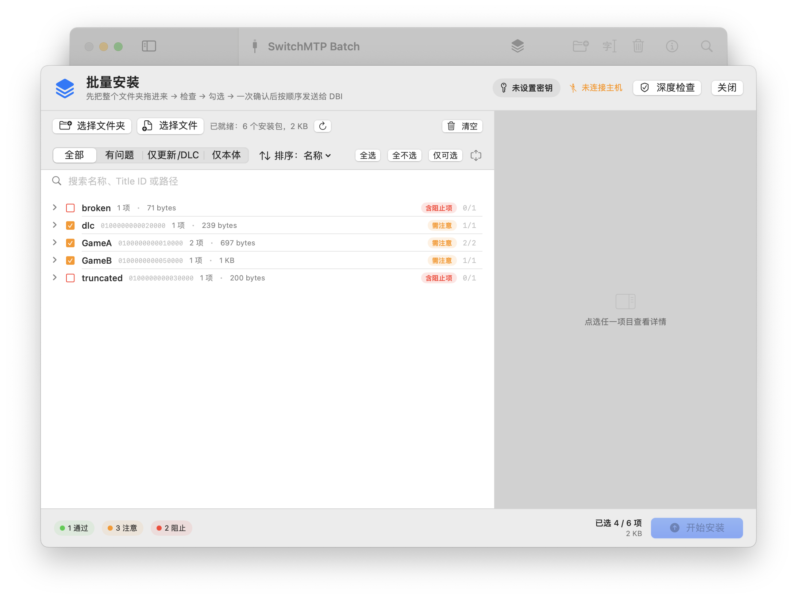

# SwitchMTP Batch：批量安装工作区

本工作区在 [SwitchMTP](https://github.com/fratei/SwitchMTP)（上游 macOS MTP 客户端，GPL-2.0）之上加了一层批量安装流程；上游的 MTP 传输、DBI 连接、安装队列原样保留，新增的是“先收集 → 再检查 → 后安装”这一层。

界面语言跟随系统设置：上游的 String Catalog 已编译进包，简体中文、繁体中文、日文、西班牙文、俄文都会自动切换；批量工作区自身的文案是中文。

参考了 [ThePromium/switchdownloader](https://github.com/ThePromium/switchdownloader) 的界面组织方式（递归扫描、按本体/更新/DLC 分组、先列清单再安装），但**没有复用它的任何代码**——那个仓库没有 LICENSE 文件，只有界面思路可借鉴。

## 它解决了原来的什么问题

- **能拖文件夹了。** 原版只接受单个 `.nsp/.nsz/.xci/.xcz` 文件，拖文件夹没有反应。现在拖入整个游戏库目录会递归扫描任意层子文件夹。
- **不再“拖进去就开始传”。** 原来拖入即上传，没法先看清里面有什么。现在扫描、检查、勾选都在本地完成，点“开始安装”并确认之后才逐个发送。
- **装之前就知道会不会变黄/变红。** 每个包在发送前先做结构预检，再可选择用你自己的 `prod.keys` 做签名与哈希的深度检查。

## 使用步骤

1. 打开 `SwitchMTP Batch.app`，点工具栏上的“批量安装”。**不需要先连 Switch**，扫描和检查都是本地操作。
2. 把游戏总目录拖进虚线框，或点“选择文件夹 / 选择文件”。加入过的目录会被记住，下次打开可以“刷新”重扫。
3. 扫描时只读文件头与表项，不传输、不改动任何文件。隐藏目录、`.git`、`node_modules`、`.app`、`$RECYCLE.BIN`、`System Volume Information` 和符号链接会被跳过。
4. 扫描结果按标题分组。Title ID 依次取自 `<id>.cnmt.nca`、ticket 文件名（`.tik` 前 16 位）、最后才是文件名里的 `[0100…]` 括号——很多整合包把 CNMT 命名成内容哈希，只有 ticket 里才有真 ID。有了 ID 才能判断类型：末四位是 `<偶数Y>000` 的是本体、`<Y>800` 的是更新、带 `0x1000` 位（奇 Y）的是 DLC；组内按 本体 → 更新 → DLC 排序，默认勾选非“阻止”的项。
5. 用顶部筛选（全部 / 有问题 / 仅更新与 DLC / 仅本体）、排序、搜索快速定位；点任一条目，右侧显示路径、大小、Title ID、NCA 数量、TICKET/CNMT、检查条目。
6. 连接 Switch，在 DBI 里进入 MTP responder，回到这里点“开始安装”。确认页会冻结这次的计划（项目数、总大小、目标 SD/NAND、通过/注意计数），确认后按顺序发送。
7. **进度看 Switch 屏幕。** 这个应用只负责把文件送进 DBI 的安装口；发送成功不等于安装成功，装完 DBI 才会给出它自己的结果。



## 游戏封面

分组行左侧的小方块是游戏封面，**不是从安装包里解出来的**。零售 NSP/XCI 的 256×256 图标存在 control NCA 的 NACP 里，要读它得先用 `prod.keys` 解密 control NCA、再走它的 romfs——参考项目 `switchdownloader` 也没这么做，它是按 Title ID 从网上取图。

这里的做法：按本体 Title ID 请求 `https://api.nlib.cc/nx/<TitleID>/icon/256`，拿回约 40 KB 的 eShop 原图，缓存在 `~/Library/Application Support/SwitchMTP Batch/GameIcons/<TitleID>.jpg`。同一款游戏只会请求一次，第二次打开直接读本地缓存，所以断网也能显示。为了不把请求一次全打出去，同一时间最多 4 个并发，传输失败/429/5xx 会自动重试一次；目录里确实没有这款游戏（404）时不重试，行里显示手柄占位图。想重试整批，点筛选栏里的“重新获取封面”按钮，它会清掉失败记录、只补没有封面的那些。

分组名不再取本地文件/文件夹名，而是按 Title ID 查官方名称，优先级：**简体中文 → 繁體中文 → English**。

- 简体：`CN.zh.json`（国行目录，约 109 款，260 KB）
- 繁體：`HK.zh.json`（港服目录，22 628 款，压缩后约 16 MB）
- 英文：`api.nlib.cc/nx/<TitleID>?fields=name`，只给前两者都没有的少数标题兜底

两个中文库第一次使用时下载一次（十几秒），抽成 `标题 ID → 名称` 表（约 1 MB）缓存在 `~/Library/Application Support/SwitchMTP Batch/Catalog/LocalizedNames.json`，之后启动不再联网。同一个 Title ID 在目录里可能对应多个商品（本体、本体+扩展票、Switch 2 Edition 等），只保留最朴素的那个名字。本地文件夹名只在目录完全查不到时作为兜底显示。

港服目录是繁体，所以显示时再做一层本地繁转简（`Resources/T2S.json`，OpenCC 字表 + 任天堂系列译名，约 60 KB，不联网）：先匹配 `瑪利歐→马力欧`、`瑪利歐賽車→马力欧卡丁车`、`薩爾達→塞尔达` 这类整词，再走单字表。国行目录有简体条目时直接用官方简体，不会被转换覆盖。这只是字形转换，不是官方译名翻译。

参考项目走的是另一条路：先下载 90 MB 的 `blawar/titledb` 总索引，再按 `iconUrl` 到 Nintendo 图片 CDN 取图。索引太大，在国内容易下不完，所以这里换成按 Title ID 的单次查询。

## 三种颜色代表什么

| 颜色 | 含义 | 触发条件 |
| --- | --- | --- |
| 绿 · 通过 | 容器结构完整 | PFS0/HFS0 表、偏移、大小、重名、截断全部正常，且能找到 NCA、CNMT 与 ticket |
| 黄 · 注意 | 可以装，但有可疑点 | 缺 ticket、缺 CNMT；深度检查发现签名非官方；或密钥代不足、BKTR 补丁分区导致“无法验证” |
| 红 · 阻止 | 不建议装 | 魔数不对、表越界、数据被截断、条目重叠、一个 NCA 都没有 |

需要说清楚的一点：**这是安装前的静态预检，不是复刻 DBI 的安装逻辑。** DBI 装完给出的绿/黄/红来自它自己的校验流程；本应用的黄色同样常对应签名、票据类问题，但两边实现不同，结论不能保证一一对应。文档和界面里都不承诺“和 DBI 颜色完全一致”。

## 深度检查（签名与哈希）

点右上角“未设置密钥”选择你自己的 `prod.keys`，然后点“深度检查”。它会对当前勾选的包（没勾选时对全部）逐个运行内置的 `hactool`；NSZ 会先由内置的 `nszunpack` 解包成临时 NSP，再走同一套流程（细节见 [docs/NSZ_UNPACK.md](docs/NSZ_UNPACK.md)）：

- `hactool` 只负责解密 NCA 头、验证 RSA 签名链与内容哈希；本应用运行它、解析输出、翻译成同样的三态。
- 输出里的 `Signature (FAIL)` / `Fixed-Key Signature (FAIL)` → **黄色**（签名非官方）；`Hash (FAIL)`、NCA 头读不出来 → **红色**；只有出现 `Signature (GOOD)` / `Hash (GOOD)` 才记为**已验证**。
- 密钥代不够（`Are keys correct?`、`Unable to match rights id to titlekey`）→ **无法验证**，不会误报成“签名错误”。
- `hactool` 即使全部校验失败也返回退出码 0，所以判级只能靠文本，不能靠退出码。

关于密钥的边界：

- 只在本机读取，不上传、不写日志、不进报告。
- 校验引擎需要文件路径，因此检查期间会在系统临时目录放一份 `0600` 权限的副本，本次检查结束立即删除。
- 偏好里只记住**文件路径**，不保存密钥内容；换机器或删掉文件后需要重新选择。
- 应用不提供密钥下载、密钥获取、签名绕过或固件修改。

**固件不是必需品。** 结构检查、签名与哈希验证都只依赖 `prod.keys`；只有做系统级安装、固件升级这类操作才需要固件镜像。缺固件不影响这里的任何结论。

## 已知限制

- **NSZ 已支持解包校验**：NCZ 会被解压并按 section 重加密还原成 NCA，重建结果还会和包内 `.cnmt.xml` 的哈希逐字节对照。没有 `.cnmt.xml` 的第三方重打包只能用引擎的签名/哈希结论，会注明“无清单可对照”。
- **XCZ 仍是外层检查**：它是卡带镜像（HFS0 + sparse），和 NSZ 的 NCZ 不是一套格式，暂不支持解包。
- **BKTR 补丁分区**：hactool 不支持遍历这类分区，对应 NCA 只会报“签名未判定”，不会被误判成损坏。
- 真机端到端只覆盖少量样本（本体、更新、DLC 各一个），完整库没有逐包跑过；MTP 传输成功 ≠ 安装成功的语义已在界面和确认页写明。
- Xcode 构建是 arm64 + x86_64 通用包。
- 构建出的 app 没有启用 App Sandbox：批量扫描任意游戏库目录需要读权限，调用 `hactool` 也需要能读到临时副本。分发时请自行签名。
- 深度检查一次只处理一个包，串行执行；几百个包的大库会比较慢（每个包一次进程启动）。

## 构建与测试

```sh
./scripts/build-xcode-app.sh     # 标准构建：XcodeGen + xcodebuild
./scripts/test-inspector.sh      # 合成样本 + 容器解析/判级断言
```

推荐用 Xcode 构建：`build-xcode-app.sh` 用 XcodeGen 生成工程，再用 `xcodebuild` 产出 arm64 + x86_64 通用包，图标目录、String Catalog、Info.plist 处理、Hardened Runtime 都由 Xcode 完成。

## 许可

- 本工程继承上游的 **GPL-2.0**，新增文件同样适用。
- 内置的 `hactool` 为 **ISC** 许可，许可证随包放在 `Contents/Resources/bin/hactool-LICENSE.txt`。
- `switchdownloader` 仅作界面参考，未复制代码。
